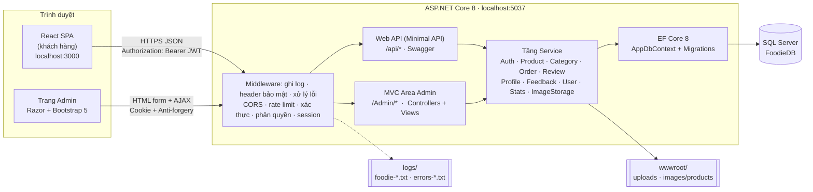
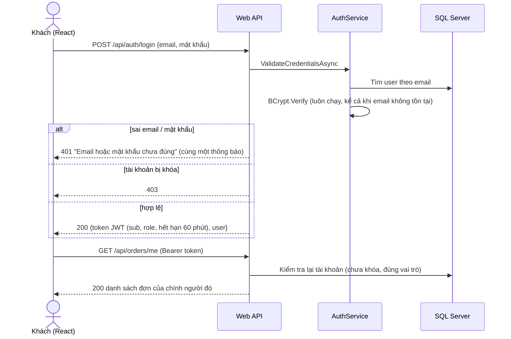
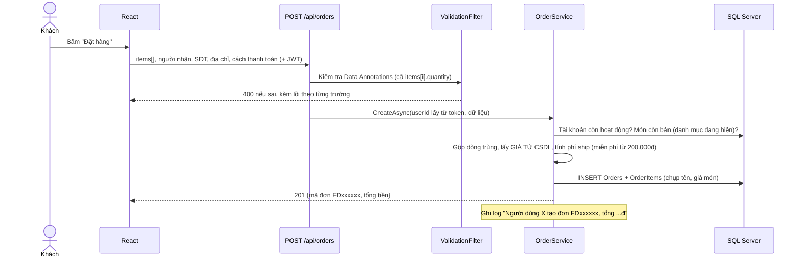

# Kiến trúc hệ thống: Foodie

## 1. Tổng quan

Foodie gồm **hai giao diện dùng chung một backend**:

- **Trang khách hàng:** ứng dụng React (SPA), gọi **Web API** bằng JWT.
- **Trang quản trị:** **ASP.NET Core MVC** (Razor Views) chạy ngay trên backend, đăng nhập bằng Cookie.

Cả hai đi qua cùng một **tầng Service** chứa toàn bộ nghiệp vụ, nên quy tắc (giá, phí ship, luồng trạng thái đơn, quyền...) chỉ viết **một lần**.



## 2. Các tầng

| Tầng | Thư mục | Vai trò |
|---|---|---|
| Giao diện khách hàng | `Frontend/REACT-VITE-FOODIE/src` | React 18 + Vite + Ant Design. Điều hướng bằng state, gọi API qua `services/*.service.js` (axios) |
| Giao diện quản trị | `FoodieAPI/Areas/Admin` | MVC: Controllers, ViewModels (Data Annotations), Razor Views, AJAX (`wwwroot/admin/admin.js`) |
| Web API | `FoodieAPI/Endpoints` | Minimal API theo REST; chỉ nhận request, kiểm tra dữ liệu (`ValidationFilter`), rồi gọi Service |
| Nghiệp vụ | `FoodieAPI/Services` | Mọi quy tắc nghiệp vụ, dùng chung cho API và MVC |
| Truy xuất dữ liệu | `FoodieAPI/Data`, `Models`, `Migrations` | EF Core, LINQ, cấu hình quan hệ, migration, dữ liệu mẫu |
| Dùng chung | `FoodieAPI/Common` | Cấu hình xác thực, Swagger, log, kiểm tra Data Annotations, hằng số, tiện ích |
| Kiểm thử | `FoodieAPI.Tests` | xUnit: unit test + integration test qua HTTP trên CSDL tạm |

## 3. Hai cơ chế xác thực

| | Web API (`/api/*`) | Trang quản trị (`/Admin/*`) |
|---|---|---|
| Người dùng | Khách hàng (React) và admin (Swagger, test) | Admin |
| Cơ chế | **JWT** trong header `Authorization: Bearer` | **Cookie** `HttpOnly`, `SameSite=Lax`, hết hạn sau 2 giờ (gia hạn khi hoạt động) |
| Chống CSRF | Không cần: trình duyệt không tự gửi header Bearer | **Anti-forgery token** bắt buộc cho mọi POST (form và AJAX) |
| Lỗi chưa đăng nhập | 401 JSON (ProblemDetails) | Chuyển về `/Admin/Account/Login` |
| Tách biệt | Cookie admin **không** dùng được cho `/api` | JWT **không** dùng được cho `/Admin` |

Scheme "Smart" chọn cơ chế theo đường dẫn (`Common/AuthenticationSetup.cs`). Ở **mỗi request**, server kiểm tra lại tài khoản trong CSDL
(còn tồn tại, chưa bị khóa, vai trò không đổi), nên **khóa tài khoản có hiệu lực ngay**, không phải đợi token hết hạn.



## 4. Luồng đặt hàng (ví dụ xử lý một nghiệp vụ)



## 5. Xử lý lỗi và ghi log

- **Lỗi nghiệp vụ** (`ApiException`): Service ném ra kèm mã HTTP.
  - API trả về `application/problem+json` (có `errors` theo từng trường).
  - MVC đưa lỗi vào `ModelState` để hiện ngay trên form, hoặc dùng TempData.
- **Lỗi không lường trước:**
  - API: `ErrorHandlingMiddleware` trả 500 dạng JSON, không lộ chi tiết (trừ môi trường Development).
  - MVC: `UseExceptionHandler("/Error")` hiện trang lỗi kèm mã tra cứu.
- **Log** (Serilog, `Common/LoggingSetup.cs`):
  - `logs/foodie-<ngày>.txt`: mọi sự kiện và mỗi request HTTP.
  - `logs/errors-<ngày>.txt`: chỉ cảnh báo và lỗi.
  - Giữ 14 ngày.

## 6. Quản lý trạng thái

| Cơ chế | Dùng cho |
|---|---|
| **JWT** (localStorage của trình duyệt) | Phiên đăng nhập của khách trên React |
| **Cookie xác thực** | Phiên đăng nhập trang quản trị |
| **Session** (server) | Ghi nhớ bộ lọc / trang đang xem ở từng danh sách quản trị |
| **TempData** | Thông báo một lần sau khi chuyển trang ("Đã thêm món...") theo mẫu Post-Redirect-Get |
| **localStorage** | Giỏ hàng (giữ cả khi chưa đăng nhập, sau F5) |

## 7. Công nghệ

| Phần | Công nghệ |
|---|---|
| Backend | .NET 8, ASP.NET Core MVC + Minimal API, EF Core 8 (SQL Server), BCrypt.Net, Serilog, Swashbuckle (Swagger) |
| Trang quản trị | Razor, Bootstrap 5, Bootstrap Icons, jQuery Validation Unobtrusive |
| Trang khách hàng | React 18, Vite 5, Ant Design 5, axios, Leaflet + OpenStreetMap |
| Kiểm thử | xUnit, Microsoft.AspNetCore.Mvc.Testing |
| Cấu hình bí mật | .NET User Secrets (Development), biến môi trường (Production) |

## 8. Cấu trúc thư mục

```text
FoodieProject/
├── docs/                         Tài liệu: kiến trúc, CSDL, use case, API, bảo mật, test cases
├── FoodieBackend/
│   ├── FoodieSolution.sln
│   ├── scripts/setup-secrets.ps1 Cấu hình User Secrets (chạy 1 lần)
│   ├── FoodieAPI/
│   │   ├── Areas/Admin/          Trang quản trị MVC (Controllers, Models, Views)
│   │   ├── Common/               Xác thực, Swagger, log, validation, hằng số
│   │   ├── Controllers/          Trang lỗi chung (MVC)
│   │   ├── Data/                 AppDbContext, Seeder
│   │   ├── DTOs/                 Dữ liệu vào/ra của API (có Data Annotations)
│   │   ├── Endpoints/            Web API (Minimal API)
│   │   ├── Middlewares/          Xử lý lỗi của API
│   │   ├── Migrations/           EF Core migrations
│   │   ├── Models/               Entity (bảng CSDL)
│   │   ├── Services/             Nghiệp vụ
│   │   ├── wwwroot/              admin.js/css, images/products (ảnh món), uploads (ảnh tải lên)
│   │   └── Program.cs            Cấu hình DI, middleware, route
│   └── FoodieAPI.Tests/          Kiểm thử tự động (xUnit)
└── Frontend/REACT-VITE-FOODIE/
    ├── public/                   banners/, logo.png
    └── src/
        ├── components/           common, home, products, contact
        ├── config/               banners.js, contact.js, about.js (nội dung chỉnh được)
        ├── hooks/                useAuthView (đăng nhập, điều hướng)
        ├── pages/                Trang chủ, Thực đơn, Chi tiết, Giỏ hàng, Đơn của tôi, Tài khoản, Về chúng tôi...
        ├── services/             Gọi API (axios)
        └── utils/helpers.js
```
