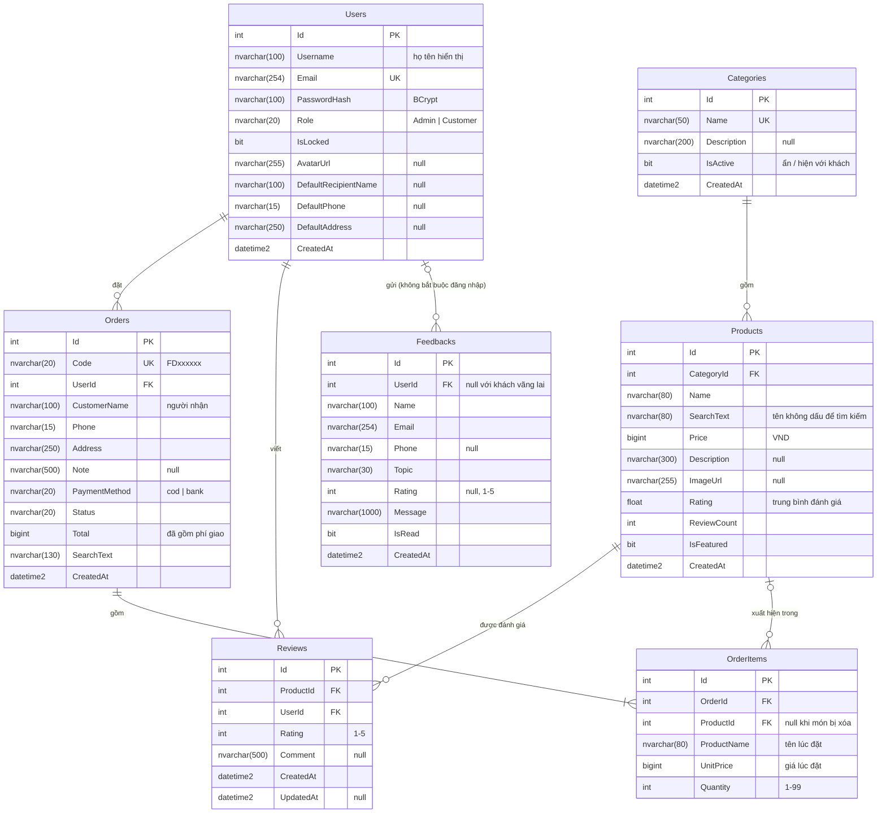

# Thiết kế cơ sở dữ liệu: Foodie

- **Hệ quản trị:** SQL Server (tên CSDL mặc định `FoodieDB`).
- **Truy xuất dữ liệu:** Entity Framework Core 8, code-first. Bảng sinh từ các lớp trong `FoodieBackend/FoodieAPI/Models/`,
  cấu hình quan hệ trong `Data/AppDbContext.cs`.
- **Tạo và cập nhật CSDL:** EF Core Migrations (`Migrations/`). Ứng dụng tự áp dụng migration còn thiếu khi khởi động
  (`Database.MigrateAsync()`), sau đó `Data/Seeder.cs` tạo tài khoản admin và thực đơn mẫu nếu CSDL còn trống.

## 1. Sơ đồ quan hệ thực thể (ERD)



## 2. Các quan hệ và quy tắc khi xóa

| Quan hệ | Bản số | Khi xóa bản ghi cha | Lý do thiết kế |
|---|---|---|---|
| Categories → Products | 1 – n | **Restrict** (không cho xóa) | Không để món "mồ côi". Admin chuyển món sang danh mục khác, hoặc **ẩn** danh mục thay vì xóa |
| Users → Orders | 1 – n | **Restrict** | Lịch sử đơn hàng và doanh thu phải được giữ lại |
| Orders → OrderItems | 1 – n | **Cascade** | Dòng món là một phần của đơn, xóa đơn thì xóa theo |
| Products → OrderItems | 1 – n | **Set NULL** | Món ngừng bán vẫn để đơn cũ nguyên vẹn: `ProductName` và `UnitPrice` được **chụp lại lúc đặt** |
| Products → Reviews | 1 – n | Cascade | Đánh giá gắn với món |
| Users → Reviews | 1 – n | Cascade | Đánh giá gắn với tài khoản |
| Users → Feedbacks | 0..1 – n | **Set NULL** | Góp ý vẫn có giá trị với chủ shop dù tài khoản bị xóa; khách vãng lai không có tài khoản |

## 3. Ràng buộc và chỉ mục

| Bảng | Ràng buộc / chỉ mục | Mục đích |
|---|---|---|
| Users | `Email` **UNIQUE** | Mỗi email một tài khoản (kể cả hai yêu cầu đăng ký cùng lúc) |
| Categories | `Name` **UNIQUE** | Không trùng tên danh mục (collation SQL Server không phân biệt hoa thường) |
| Orders | `Code` **UNIQUE**; index `Status`, `CreatedAt`, `UserId` | Mã đơn duy nhất; lọc đơn theo trạng thái, thời gian; "Đơn của tôi" |
| Reviews | (`ProductId`, `UserId`) **UNIQUE** | Mỗi khách **1 đánh giá cho mỗi món** |
| Products | index `CategoryId`, `CreatedAt` | Lọc theo danh mục, sắp xếp mới nhất |
| Feedbacks | index (`IsRead`, `CreatedAt`) | Danh sách góp ý chưa đọc, mới nhất trước |

Độ dài mọi cột chuỗi lấy từ **Data Annotations** (`[StringLength]`, `[Required]`, `[Range]`) trên các lớp Model, nên không có cột `nvarchar(max)`.

## 4. Quyết định thiết kế đáng chú ý

- **Tiền tệ lưu `bigint` (VND, số nguyên):** tiền Việt không có phần lẻ, tránh sai số của kiểu số thực.
- **Giá và tên món được "chụp" vào `OrderItems`:** admin đổi giá hoặc xóa món sau này không làm thay đổi đơn đã đặt và doanh thu cũ.
- **`SearchText` (tên không dấu, viết thường):** tìm "pho" hay "phở" đều ra "Phở bò", truy vấn bằng `LIKE` thường có index hỗ trợ.
- **`Rating`, `ReviewCount` lưu sẵn trên `Products`:** tính lại mỗi khi có đánh giá thêm, sửa hoặc xóa, để danh sách món không phải chạy `AVG` trên bảng `Reviews` mỗi lần tải.
- **Giỏ hàng không lưu CSDL:** giỏ nằm ở trình duyệt (localStorage) để khách chưa đăng nhập vẫn thêm món được. Khi đặt hàng, server **lấy lại giá từ CSDL**, không tin giá client gửi lên.
- **Không lưu thông tin thẻ thanh toán:** `PaymentMethod` chỉ ghi cách thanh toán (`cod` / `bank`). Không lưu số thẻ hay CVV (chuẩn PCI DSS cấm lưu CVV).
- **Thời gian lưu UTC** (`datetime2`), hiển thị theo giờ Việt Nam (UTC+7) ở giao diện.

## 5. Lịch sử migration

| Migration | Thay đổi |
|---|---|
| `InitialCreate` | Users, Categories, Products, Orders, OrderItems + các quan hệ, chỉ mục |
| `AddUserProfile` | Users thêm `AvatarUrl`, địa chỉ mặc định (3 cột). Thêm cột cho phép NULL nên không mất dữ liệu cũ |
| `AddFeedback` | Bảng Feedbacks (góp ý) |
| `AddReviews` | Bảng Reviews, `Products.ReviewCount`; đặt lại `Rating` về 0 (bỏ điểm nhập tay, chỉ dùng đánh giá thật) |

Lệnh tham khảo (tại `FoodieBackend/FoodieAPI`):

```powershell
dotnet ef migrations list          # xem các migration
dotnet ef migrations add <Ten>     # tạo migration mới sau khi sửa Model
dotnet ef database update          # áp dụng thủ công (ứng dụng cũng tự áp dụng khi khởi động)
```
