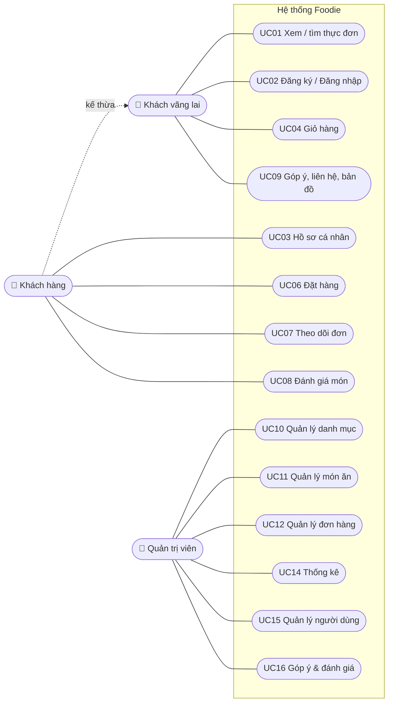
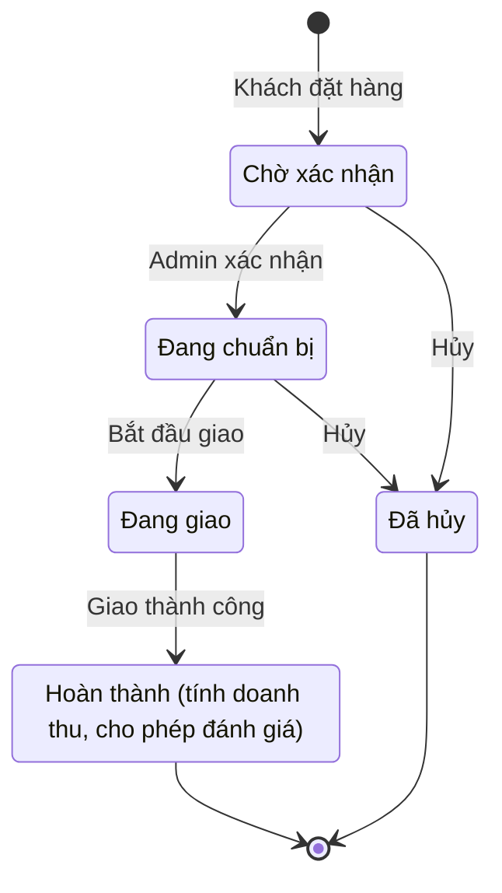

# Phân tích yêu cầu và Use case: Foodie

Mã use case giữ đúng như báo cáo M2/M3 để tiện đối chiếu. Cột **Trạng thái** cho biết hệ thống hiện tại đã làm hay chưa.

## 1. Tác nhân

| Tác nhân | Mô tả | Cách truy cập |
|---|---|---|
| **Khách vãng lai** (Guest) | Chưa đăng nhập | Trang khách hàng (React) |
| **Khách hàng** (Customer) | Đã có tài khoản; **kế thừa** mọi quyền của khách vãng lai | Trang khách hàng, đăng nhập bằng JWT |
| **Quản trị viên** (Admin) | Quản lý cửa hàng | Trang quản trị MVC `/Admin` (Cookie) và API `/api/admin/*` |

Vai trò được gán **phía server** (đăng ký luôn là Customer) và kiểm tra **phía server** ở mọi request.

## 2. Danh sách use case

| Mã | Use case | Tác nhân | Trạng thái |
|---|---|---|---|
| UC01 | Xem thực đơn, tìm kiếm (không dấu), lọc danh mục, xem món bán chạy | Guest, Customer | ✅ |
| UC02 | Đăng ký / Đăng nhập / Đăng xuất | Guest | ✅ |
| UC03 | Quản lý hồ sơ: họ tên, ảnh đại diện, mật khẩu, địa chỉ mặc định | Customer | ✅ |
| UC04 | Quản lý giỏ hàng | Guest, Customer | ✅ (giỏ lưu ở trình duyệt) |
| UC05 | Áp dụng mã giảm giá | Customer | ⏳ Hướng phát triển |
| UC06 | Đặt hàng và chọn cách thanh toán (COD / chuyển khoản) | Customer | ✅ |
| UC07 | Xem lịch sử và theo dõi tiến độ đơn hàng | Customer | ✅ |
| UC08 | Đánh giá món đã mua (1–5 sao + nhận xét) | Customer | ✅ |
| UC09 | Gửi góp ý cho chủ shop; xem vị trí cửa hàng, số điện thoại | Guest, Customer | ✅ |
| UC10 | Quản lý danh mục (thêm/sửa/xóa, ẩn/hiện) | Admin | ✅ |
| UC11 | Quản lý món ăn (thêm/sửa/xóa, ảnh, món nổi bật) | Admin | ✅ |
| UC12 | Quản lý đơn hàng (lọc, xem chi tiết, chuyển trạng thái) | Admin | ✅ |
| UC13 | Quản lý mã giảm giá | Admin | ⏳ Hướng phát triển |
| UC14 | Thống kê: doanh thu, số đơn, khách hàng, món bán chạy | Admin | ✅ |
| UC15 | Quản lý người dùng: tìm kiếm, khóa / mở khóa | Admin | ✅ (bổ sung so với báo cáo) |
| UC16 | Đọc / xử lý góp ý, kiểm duyệt đánh giá | Admin | ✅ (bổ sung so với báo cáo) |

## 3. Sơ đồ use case

> Ghi chú cho sơ đồ UML trong báo cáo: **UC02 không nên `<<include>>` vào UC06**. Đăng nhập là **điều kiện tiên quyết**
> (pre-condition) của đặt hàng chứ không phải một bước con của nó. UC05 (mã giảm giá) `<<extend>>` UC06 khi được làm trong tương lai.

## 4. Quy tắc nghiệp vụ

| Mã | Quy tắc | Nơi kiểm tra |
|---|---|---|
| BR01 | Phí giao 15.000đ; **miễn phí khi tạm tính từ 200.000đ** | `OrderService.ShippingFeeFor` |
| BR02 | Giá món luôn lấy từ CSDL lúc đặt; tổng tiền client gửi lên bị bỏ qua | `OrderService.CreateAsync` |
| BR03 | Mỗi đơn 1–50 dòng; mỗi món 1–99 phần (cộng dồn khi trùng món) | DTO + `OrderService` |
| BR04 | Chỉ đặt được món thuộc danh mục **đang hiển thị** | `OrderService` |
| BR05 | Luồng trạng thái đơn: Chờ xác nhận → Đang chuẩn bị → Đang giao → Hoàn thành; **chỉ hủy được khi chưa giao** | `OrderStatuses.CanChange` |
| BR06 | Doanh thu và món bán chạy **chỉ tính đơn đã hoàn thành** | `StatsService` |
| BR07 | Chỉ khách có **đơn hoàn thành chứa món** mới được đánh giá; mỗi khách **1 đánh giá / món** | `ReviewService` + unique index |
| BR08 | Không xóa danh mục còn món (ẩn danh mục thay vì xóa) | FK Restrict + `CategoryService` |
| BR09 | Xóa món không làm đổi đơn cũ (tên, giá đã chụp vào OrderItems) | FK Set NULL |
| BR10 | Tài khoản bị khóa không đăng nhập, không đặt hàng được, phiên cũ bị hủy ngay; không khóa được admin | `AuthService`, `UserService` |
| BR11 | Ảnh: chỉ JPG/PNG thật, tối đa 2MB, tên file do server đặt | `ImageStorage` |

## 5. Đặc tả use case chi tiết

### UC02: Đăng nhập

| Mục | Nội dung |
|---|---|
| Tác nhân | Khách vãng lai |
| Tiền điều kiện | Đã có tài khoản |
| Hậu điều kiện | Nhận JWT (hết hạn sau 60 phút), giao diện hiện tên và ảnh đại diện |

**Luồng chính**
1. Khách nhập email và mật khẩu, bấm "Đăng nhập".
2. Hệ thống kiểm tra định dạng (bắt buộc nhập, độ dài).
3. Hệ thống tìm tài khoản theo email (không phân biệt hoa thường) và so mật khẩu bằng BCrypt.
4. Hệ thống trả JWT và thông tin tài khoản; giao diện chuyển về trang chủ (hoặc giỏ hàng nếu giỏ có món).

**Luồng ngoại lệ**
- 2a. Thiếu email / mật khẩu → báo lỗi ngay dưới ô nhập (400).
- 3a. Sai email **hoặc** sai mật khẩu → cùng một thông báo "Email hoặc mật khẩu chưa đúng" (401), để không dò được email nào đã đăng ký. Ghi log cảnh báo.
- 3b. Đúng mật khẩu nhưng tài khoản bị khóa → "Tài khoản của bạn đã bị khóa" (403).
- 3c. Quá 10 lần thử trong 1 phút từ cùng một IP → 429 "Bạn thao tác quá nhanh".
- 4a. Tài khoản khách hàng đăng nhập vào trang quản trị → "Tài khoản này không có quyền quản trị".

### UC06: Đặt hàng

| Mục | Nội dung |
|---|---|
| Tác nhân | Khách hàng |
| Tiền điều kiện | Đã đăng nhập; giỏ hàng có ít nhất 1 món |
| Hậu điều kiện | Đơn mới ở trạng thái "Chờ xác nhận", giỏ hàng được làm trống, đơn hiện ở trang quản trị |

**Luồng chính**
1. Khách bấm "Thanh toán" ở giỏ hàng.
2. Hệ thống hiện hộp thông tin giao hàng; **địa chỉ mặc định được chọn sẵn** (nếu có).
3. Khách chọn cách thanh toán (tiền mặt khi nhận / chuyển khoản), nhập ghi chú (không bắt buộc), bấm "Đặt hàng".
4. Hệ thống kiểm tra dữ liệu, lấy giá từ CSDL, gộp dòng trùng, tính phí ship (BR01–BR04).
5. Hệ thống lưu đơn và các dòng món (chụp tên, giá), sinh mã đơn `FDxxxxxx`, ghi log.
6. Giao diện báo "Đặt hàng thành công", có nút "Theo dõi đơn hàng".

**Luồng thay thế**
- 2a. Chưa đăng nhập → chuyển tới trang đăng nhập; giỏ hàng **vẫn được giữ**.
- 2b. Khách chọn "Giao tới địa chỉ khác" → nhập người nhận, SĐT, địa chỉ; có thể tick "Đặt làm địa chỉ mặc định".

**Luồng ngoại lệ**
- 4a. SĐT sai định dạng, thiếu địa chỉ, số lượng ngoài 1–99... → 400, lỗi hiện đúng ô (kể cả `items[i].quantity`).
- 4b. Có món đã ngừng bán hoặc thuộc danh mục bị ẩn → 400 "Có món trong giỏ không còn bán. Vui lòng tải lại thực đơn."
- 4c. Tài khoản vừa bị khóa → token bị từ chối ngay ở bước xác thực (401); giao diện tự đăng xuất và chuyển về trang đăng nhập kèm thông báo.

### UC08: Đánh giá món

| Mục | Nội dung |
|---|---|
| Tác nhân | Khách hàng |
| Tiền điều kiện | Đã đăng nhập; có **đơn hoàn thành** chứa món (BR07) |
| Hậu điều kiện | Đánh giá được lưu; điểm trung bình và số lượt của món được tính lại |

**Luồng chính**
1. Khách mở "Đơn của tôi" → đơn đã hoàn thành → bấm "Đánh giá" ở món (hoặc mở trang chi tiết món).
2. Hệ thống kiểm tra quyền đánh giá và hiện ô "Viết đánh giá".
3. Khách chọn 1–5 sao, viết nhận xét (không bắt buộc, tối đa 500 ký tự), bấm "Gửi đánh giá".
4. Hệ thống lưu đánh giá, tính lại điểm trung bình, ghi log; danh sách đánh giá cập nhật.

**Luồng thay thế**
- 3a. Khách đã đánh giá món này → gửi lại là **sửa** đánh giá cũ (không tạo thêm); có thể **xóa** đánh giá của mình.

**Luồng ngoại lệ**
- 2a. Chưa mua, đơn chưa giao xong hoặc đơn đã hủy → không hiện ô đánh giá; nếu gọi API trực tiếp → 403.
- 3b. Không chọn sao / quá 500 ký tự → 400.
- 4a. Quản trị viên xóa đánh giá không phù hợp → điểm trung bình tự tính lại.

### UC12: Quản lý đơn hàng

| Mục | Nội dung |
|---|---|
| Tác nhân | Quản trị viên |
| Tiền điều kiện | Đăng nhập trang quản trị |
| Hậu điều kiện | Trạng thái đơn được cập nhật; khách thấy tiến độ mới; doanh thu tính khi đơn hoàn thành |

**Luồng chính**
1. Admin mở "Đơn hàng"; lọc theo trạng thái, tìm theo mã đơn hoặc tên người nhận (không dấu). Danh sách tải bằng AJAX, có phân trang.
2. Admin mở chi tiết đơn: các món, tạm tính, phí ship, tổng, thông tin giao hàng, tài khoản đặt.
3. Hệ thống chỉ hiện **các nút chuyển trạng thái hợp lệ** (BR05).
4. Admin bấm chuyển trạng thái → hệ thống cập nhật, ghi log người thực hiện, hiện thông báo.

**Luồng ngoại lệ**
- 4a. Chuyển sai luồng (ví dụ "Chờ xác nhận" → "Hoàn thành", hoặc hủy khi đang giao) → từ chối, báo lý do.
- 4b. Hai admin cùng đổi một đơn → người sau nhận thông báo "Đơn hàng vừa được người khác cập nhật" (409), không ghi đè.

### UC11: Quản lý món ăn

| Mục | Nội dung |
|---|---|
| Tác nhân | Quản trị viên |
| Tiền điều kiện | Đăng nhập trang quản trị |
| Hậu điều kiện | Thực đơn trên trang khách hàng cập nhật ngay |

**Luồng chính**
1. Admin mở "Món ăn": tìm (không dấu), lọc danh mục bằng AJAX, phân trang; bộ lọc được nhớ trong Session.
2. Admin bấm "Thêm món": nhập tên, danh mục, giá, mô tả, chọn ảnh (tải lên hoặc chọn từ thư viện ảnh), đánh dấu món nổi bật.
3. Hệ thống kiểm tra dữ liệu (phía trình duyệt và phía server), lưu ảnh an toàn (BR11), lưu món.
4. Hệ thống quay về danh sách và hiện thông báo "Đã thêm món" (TempData).

**Luồng thay thế**
- 2a. Sửa món: đổi ảnh thì ảnh tải lên cũ tự bị xóa; có thể gỡ ảnh.
- 2b. Xóa món: hỏi xác nhận; đơn cũ vẫn giữ tên và giá món (BR09).

**Luồng ngoại lệ**
- 3a. Thiếu tên, giá ngoài 1.000–10.000.000đ, danh mục không tồn tại → lỗi hiện đúng ô.
- 3b. File không phải ảnh thật, sai đuôi, quá 2MB → từ chối, không lưu file rác.

## 6. Yêu cầu phi chức năng

| Nhóm | Yêu cầu | Cách đáp ứng |
|---|---|---|
| Bảo mật | Băm mật khẩu, phân quyền phía server, chống CSRF / XSS / Open Redirect, upload an toàn, không hardcode bí mật, chống dò mật khẩu và spam | Xem `docs/Security.md` |
| Toàn vẹn dữ liệu | Khóa ngoại, ràng buộc duy nhất, quy tắc khi xóa | Xem `docs/Database.md` |
| Giao diện | Dùng tốt trên máy tính và điện thoại (từ 375px), không tràn ngang | Ant Design Grid, Bootstrap (sidebar thu gọn), bảng cuộn trong khung |
| Hiệu năng | Danh sách luôn phân trang (tối đa 50 dòng); lọc / tìm trên CSDL có chỉ mục; điểm đánh giá lưu sẵn | `Paging`, chỉ mục, `Products.Rating` |
| Theo dõi | Ghi log sự kiện và lỗi ra file theo ngày | Serilog, `logs/` |
| Kiểm thử | Kiểm thử tự động mỗi khi thay đổi | 138 test xUnit, `docs/TestCases.md` |
| Cấu hình | Chạy được trên máy mới chỉ bằng README; CSDL tự tạo bằng migration | User Secrets script, `MigrateAsync`, Seeder |

## 7. Hướng phát triển

| Tính năng | Ghi chú thiết kế |
|---|---|
| Mã giảm giá (UC05, UC13) | Bảng `Vouchers` (mã, % hoặc số tiền, đơn tối thiểu, hạn dùng, số lượt); `Orders` thêm `VoucherId`, `Discount` |
| Tồn kho | `Products.Stock`; trừ khi đặt, hoàn khi hủy; xử lý hai người đặt cùng lúc (concurrency token) |
| Thanh toán trực tuyến | Tích hợp cổng thanh toán (VNPay / MoMo); không tự lưu thông tin thẻ |
| Thông báo thời gian thực | SignalR báo admin khi có đơn mới, báo khách khi đơn đổi trạng thái |
